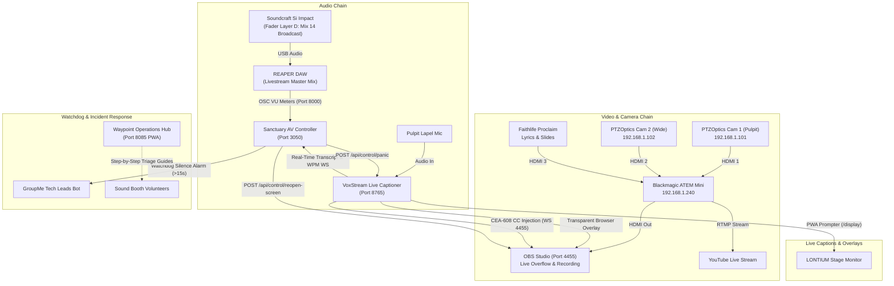

# 🌐 Waypoint AV Unified Ecosystem — Inter-App Architecture & Cross-System Map

This document establishes the unified system map, inter-process communication protocols, network directory, and cross-application failure recovery workflows across the three software repositories powering Waypoint Church's Sound Booth.

---

## 🏛️ The Three Pillars of Waypoint AV

```
┌─────────────────────────────────────────────────────────────────────────────────────────┐
│                           WAYPOINT CHURCH SOUND BOOTH STACK                             │
├─────────────────────────────┬─────────────────────────────┬─────────────────────────────┤
│ 1. Operations Hub (PWA)     │ 2. VoxStream PRO (Python)   │ 3. Sanctuary AV Controller  │
│ Port 8085 / Static PWA      │ Port 8765 / FastAPI         │ Port 3050 / Node.js         │
├─────────────────────────────┼─────────────────────────────┼─────────────────────────────┤
│ • 100% Offline Diagnostics  │ • 7 STT AI Speech Engines   │ • Real-Time Telemetry Hub   │
│ • Stage Floor Box Maps (1-23│ • Church Lexicon & Truecase │ • ATEM Touch Switcher       │
│ • Si Impact Fader Layers    │ • Offline SQLite Bible DB   │ • PTZ Camera Joystick       │
│ • Aviom Matrix & Electrical │ • PWA Stage Monitor (/display│ • REAPER OSC VU Metering    │
│ • Audio Calculators & Tone  │ • OBS CEA-608 Closed Caption│ • Silence Watchdog & GroupMe│
│ • Volunteer Step-by-Step    │ • Bionic Reading & A11y     │ • Sunday Pre-Flight Auto-Chk│
└─────────────────────────────┴─────────────────────────────┴─────────────────────────────┘
```

---

## 🗺️ Master Network & Port Directory

| Subsystem | Port / Endpoint | Protocol | Host / Target | Notes |
| :--- | :--- | :--- | :--- | :--- |
| **Operations Hub** | `8085` | HTTP / PWA | `http://localhost:8085` | Offline service worker cached sound booth operations manual. |
| **VoxStream API** | `8765` | HTTP REST & WS | `http://127.0.0.1:8765` | Real-time speech captioning, scripture cues, and overlays. |
| **Sanctuary AV Controller** | `3050` | HTTP & WS | `http://localhost:3050` | Unified telemetry, mobile stations, camera switcher. |
| **OBS WebSocket** | `4455` | WebSocket v5 | `127.0.0.1:4455` | OBS Studio remote control, recording stats, projector restore. |
| **REAPER OSC Send** | `9000` | UDP OSC | `127.0.0.1:9000` | Control commands sent from AV Controller to REAPER. |
| **REAPER OSC Recv** | `8000` | UDP OSC | `127.0.0.1:8000` | Real-time VU meter dBFS levels pushed from REAPER. |
| **ATEM Mini** | N/A (Ethernet) | Blackmagic UDP | `192.168.1.240` | Live 2-camera switcher tallies and video transitions. |
| **PTZOptics Cam 1** | `1259` | VISCA over IP / HTTP| `192.168.1.101:1259` | Pulpit / Stage Camera PTZ control and church presets. |
| **PTZOptics Cam 2** | `1259` | VISCA over IP / HTTP| `192.168.1.102:1259` | Wide Sanctuary Camera PTZ control and church presets. |
| **Faithlife Proclaim** | `52195` | HTTP REST | `192.168.1.X:52195` | Lyric slides presentation tracking and on-air state. |
| **YouTube RTMP** | `1935` | RTMP / CEA-608 | `a.rtmp.youtube.com` | Public livestream broadcast feed with closed captions. |

---

## 🔄 Cross-System Data Flow & Telemetry Loop



---

## 🛡️ Cross-System Failure Hierarchy & Redundancy Matrix

When a live service disruption occurs, follow this priority hierarchy:

| Failure Type | Affected System | Primary Automated Defense | Sound Booth Manual Override (Operations Hub) |
| :--- | :--- | :--- | :--- |
| **Total Sanctuary Network Outage** | Internet / Wi-Fi | • Operations Hub stays 100% active via PWA Service Worker cache.<br>• VoxStream falls back to local offline **Moonshine / Vosk** STT engine.<br>• REAPER DAW continues local multi-track recording. | Open `http://localhost:8085` (works offline) ➔ Follow *Offline Sunday Protocol* in Audio Hub. |
| **Silence on Broadcast Stream** | FOH Audio / Mix 14 | AV Controller Silence Watchdog detects audio `< -50 dBFS` for 15s and triggers GroupMe lead alert + red flashing UI. | 1. Check Soundcraft Si Impact Layer D, Fader 22 (Mix 14 Master).<br>2. Check REAPER master volume fader.<br>3. Verify red-taped audio cord in back of ATEM Mini. |
| **LONTIUM Stage TV Drops or Goes Black** | Video Extender / OBS Projector | AV Controller `/captions` provides 1-tap **"Reopen Screen"** button (`POST /api/control/reopen-screen`). | 1. Press push-button under booth desk to toggle BirdDog dynamic view.<br>2. Check Nest camera shared timer behind Embrace TV.<br>3. In OBS, right-click preview ➔ *Fullscreen Projector* ➔ *LONTIUM*. |
| **Both Camera Feeds Black on Switcher** | Cameras & ATEM | AV Controller `/broadcast` shows camera ICMP ping timeouts. | 1. Power cycle the **Ubiquiti white network switch under booth desk**.<br>2. Power cycle camera SDI converter boxes under desk.<br>3. Reseat camera HDMI/SDI physical connections. |
| **Inaccurate or Stuck Captions** | VoxStream | AV Controller provides 1-tap **Toggle STT** and **Panic Mute** buttons. | 1. Open `http://localhost:8765/dashboard` ➔ switch to **Useful Moonshine**.<br>2. Lower VAD silence threshold to `0.4`.<br>3. Tap Panic Mute to clear screen. |

---

## ☀️ Sunday Morning Startup Protocol (Across All 3 Apps)

Follow this 5-minute pre-service sequence every Sunday morning:

1. **Hardware Power-Up:**
   - Power up sound booth gear in sequence: `Soundcraft Console ➔ Wireless Mic Rack ➔ ATLAS Processor ➔ Crown House Amp ➔ QSC Wall Speakers ➔ ATEM Switcher ➔ Stage Aviom Switch`.
2. **Launch Software Services:**
   - **Terminal 1 (Sanctuary AV Controller):** `cd /Users/techguyowen/Downloads/AV_Controller && npm start` (Port `3050`)
   - **Terminal 2 (VoxStream PRO):** `cd /Users/techguyowen/Documents/antigravity/delightful-bohr && ./run_captioner.sh` (Port `8765`)
   - **Terminal 3 (Operations Hub):** `cd /Users/techguyowen/Downloads/Troubleshooting && python3 -m http.server 8085` (Port `8085`)
3. **Execute Automated Pre-Flight Diagnostic:**
   - Open `http://localhost:3050/checklist` on the sound booth iPad or laptop.
   - Tap **`⚡ Run Auto-Check`** and verify all 8 subsystem indicators glow Green.
   - Enter your name under Volunteer Sign-Off and submit.
4. **Stage Monitor Verification:**
   - Verify that the **LONTIUM stage TV** is showing the live speech confidence display.
   - If not, tap **"Reopen Screen"** on the AV Controller dashboard.
5. **Operations Hub Readiness:**
   - Open `http://localhost:8085` on your smartphone and sound booth monitor to have instant access to stage box maps, mixer layers, and breaker directories.
